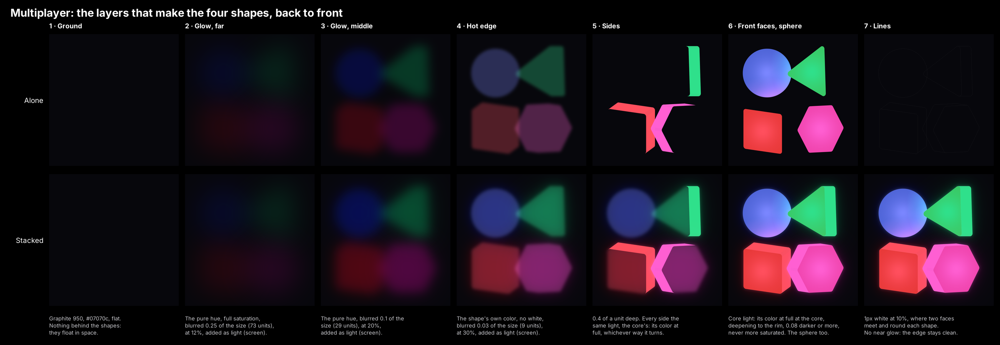

# 3D: the atom shapes as solids, and light

How to draw the four atom shapes as 3D solids that glow, and how their light falls on everything around them. This is the process behind the glowing shapes of Multiplayer, Atoms, Observed and Orbit, the light they throw on the gray solids around them, and the bonds between them. Follow it exactly and the shapes come out the same in any session, from nothing.

It builds on [shapes.md](shapes.md): the four shapes, their roles and colors, and the outlines [scripts/atom.mjs](../scripts/atom.mjs) draws. Read that first. Everything here uses **the atom shapes, never the logo mark**: the logo has its own sizes, rows and columns, and none of them apply here.

## Contents

- The unit: one 1×1 square
- Building a solid: outline, depth, turn
- Drawing a solid: faces, order, seams
- Equal depth to the eye
- Light: what the glowing shapes do to everything else
- The seven layers of a glowing shape
- Gray solids, lit
- Dithering: gradients without rings
- In space: what is not there
- Bonds between glowing shapes
- The ground, the words, the frame
- What failed, and why
- Rebuilding from scratch, step by step
- Checking the result
- Where it lives in Learn

## The unit: one 1×1 square

Every atom shape is drawn in a 1×1 square, centered on the middle of its height, then scaled. That square is **the unit**. All sizes and the depth below are shares of it.

| Shape | Core | With rounding (in the unit) |
|---|---|---|
| Circle | radius 0.40 | 0.90 × 0.90 |
| Triangle | 0.80 wide, 0.72 tall, point up | 0.90 × 0.82 |
| Square | side 0.68 | 0.78 × 0.78 |
| Hexagon | radius 0.44, points left and right | 0.98 × 0.86 |

Every corner is rounded by the same `ROUNDING = 0.05` unit. The sizes are optical: the square is smaller because it fills its cell, the hexagon has the circle's area.

**Draw all four at one unit.** Pass the same unit to every shape (`outlinePath(role, unit, 0)` in [scripts/atom.mjs](../scripts/atom.mjs)). Never scale each shape to the same width: a square as wide as the circle looks far too big. In Multiplayer the unit is 320 design pixels (the design is 1920 × 1080).

**The true center.** A shape's outline is centered on the middle of its height, which for the triangle is not where it balances. When anything must meet a shape's center (a bond, a glow, a gradient), use its true center: the centroid of its outline polygon, by the shoelace formula:

```
area = Σ (x_i · y_{i+1} − x_{i+1} · y_i)
cx   = Σ (x_i + x_{i+1}) · cross_i / (3 · area)
cy   = Σ (y_i + y_{i+1}) · cross_i / (3 · area)
```

The triangle's true center sits 0.13 of its height below the middle of its box. The circle's, square's and hexagon's are the middle.

## Building a solid: outline, depth, turn

A solid is its flat shape pushed back into depth: a **prism** for the triangle, square and hexagon, a **sphere** for the circle.

### 1. The outline as points

Take the rounded outline from `roundedOutline(role, role, 1)` (in [scripts/atom.mjs](../scripts/atom.mjs) and the film's own code). It gives corners, each with a point and an arc from one angle to another, in units of the size. Turn it into points:

- A corner whose arc is zero is one point.
- A corner with an arc is sampled along it: steps of **0.07 radians** for a solid 26 design pixels or larger, **0.3 radians** for smaller ones (they are too small for the difference to show, and it keeps files light).
- Each point is `(corner.x · s + r · cos a, corner.y · s + r · sin a)`, where `s` is the size and `r = ROUNDING · s`.

**Start the list at a corner**, never in the middle of a straight side: find the first point where the direction turns (`|sin(Δ direction)| > 0.008`) and rotate the list to begin there. Otherwise one flat side is split where the list wraps, into two faces shaded apart, with a seam between them.

### 2. The depth: 0.4 of a unit, the same for every shape

The front of the prism is the outline at `z = +depth/2`, the back at `z = −depth/2`.

**depth = 0.4 × unit, for the triangle, the square and the hexagon alike.** It is a share of the unit, never of the shape's own size: a share of each shape's size makes the widest (the hexagon) the deepest. In Multiplayer that is 0.4 × 320 = 128 design pixels.

The sphere has no depth to set: it is a sphere.

### 3. The turn

Each solid is turned and tipped in degrees: `yaw` turns it on the vertical axis (negative faces left, positive faces right), `pitch` tips it (positive faces up, negative down). Turn every point, front and back, and every normal, the same way:

```
x1 = x · cos(yaw) + z · sin(yaw)
z1 = −x · sin(yaw) + z · cos(yaw)
y' = y · cos(pitch) − z1 · sin(pitch)
z' = y · sin(pitch) + z1 · cos(pitch)
x' = x1
```

Then place it: `(cx + x', cy + y', cz + z')`. The view is orthographic: the picture shows `(x, y)`; `z` is depth toward the viewer (+z comes toward you).

**Roll**, a turn in the shape's own plane, is applied to the outline's points before the yaw and pitch: `(x cos r − y sin r, x sin r + y cos r)`. **The predicate's triangle always points up**, so roll is only ever an exception for one picture, approved by name and written into that picture's row in [shapes.md](shapes.md) (Multiplayer's triangle is rolled 27° to point left; Atoms' is turned 10°).

## Drawing a solid: faces, order, seams

1. **Sides.** Walk the outline's edges. A run of edges going the same way is **one face**: a quad from the run's first point to its last, front and back. Each arc step is its own small face, so a rounded edge is shaded in steps. Its outward normal is the edge's 2D normal `(dy, −dx)`, flipped to point away from the center, then turned like the points.
2. **Caps.** The front (normal `(0, 0, 1)` turned) and the back (`(0, 0, −1)` turned, its points reversed).
3. **Visible faces only:** keep a face if its turned normal's `z > 0`. For a convex solid seen orthographically, the kept faces cover it exactly.
4. **Order:** sides sorted by their centers' `z`, far first; **the visible cap last**, over every side.
5. **Seams:** each side carries a thin stroke in its own fill, **0.5 design pixels, beveled joins**, to close the hairline between neighboring faces. The cap carries **no stroke**: drawn last and exact, it keeps its outline clean and its rounded corners free of notches. Round joins, or a cap under the sides, put notches at the corners.

**The sphere** is not drawn as paths. It is one dithered image (see Dithering) the size of its box, each pixel computed from its surface point and normal: for a pixel at `(dx, dy)` from the center (in radii), `dz = √(1 − dx² − dy²)`, the point is `(cx + dx·r, cy + dy·r, cz + dz·r)` and the normal `(dx, dy, dz)`. Its edge is antialiased into the image's alpha: `cover = clamp((1 − |d|) · r · pixelsPerUnit + 0.5)`.

## Equal depth to the eye

All prisms have the same depth, but a side shows only as much as the shape is turned. The width of the side you see is about:

```
seen = depth × √( sin²(yaw) + (cos(yaw) · sin(pitch))² )
```

Shapes turned by different amounts look unequally deep (a hexagon turned 38° shows almost twice the side of a square turned 15°). **For equal depth to the eye, give every shape the same amount of turn, about 30° (`√(…) ≈ 0.5`), each in its own direction.** Multiplayer's: circle −30°/20°, triangle −30°/0° (rolled 27°), square −24°/−19°, hexagon 30°/−5°; each shows about 64 design pixels of side. Observed's and Orbit's triples are the exception: they face straight on, as their flat atoms did, so the triangle and the square show only their fronts, lit by the recipe all the same (`FACING_TRIPLE`: one unit, the circle as wide as a flat atom).

## Light: what the glowing shapes do to everything else

In a scene of glowing shapes, **each glowing shape is a point light** in its own color. It sits at the shape's true center, **90 design pixels in front** of the scene (`z = +90`), so faces turned toward the viewer catch some of it.

**Its color:** the shape's role color itself, no white, on the gray solids and on another glowing shape alike: light grows brighter with more of its own color, never with white. That is the light Observed's and Orbit's gray solids take: a big sphere turns blue under the circle, green by the triangle, red by the square. Multiplayer's small shapes, made before this rule, still take it mixed 50% with white (`blend(color, white, 0.5)`, a scene's `lightWhite` left unset), and keep it until he asks: their reflections read pastel.

**How strongly it reaches a point** on a face with normal `n`:

```
v        = light − point
facing   = max(0, n · v / |v|)                    a face turned from the light gets none
softened = √(|v|² + 130²)                         no surface nearer than 130: no flare up close
strength = 1.05 · facing / (1 + (softened / 220)²)   half as strong at 220, falling off as light does
```

**A face's color** is the dark's own, plus each light's color times its strength, channel by channel:

```
color = AMBIENT + Σ lightColor · strength
AMBIENT = Graphite 950 blended 85% toward Graphite 800 = #21212b   (a face no light reaches stays just above the ground)
```

What this does to each kind of object:

- **Gray solids** (the small atoms in Multiplayer, the dark atoms of Observed and Orbit) are lit only this way: faces turned to a light glow in its color, faces turned away stay near the dark, and the far ones fade, unobserved. The colors that land on them are the glowing shapes' own.
- **The glowing shapes light each other, in their own colors.** The circle receives the other lights (not its own), each its role color with no white: per pixel, add `0.6 × (lit(point, normal, others) − AMBIENT)`. That is what turns its bottom violet over the square and the hexagon, and its edge green by the triangle. Without it, they look pasted on, not in one space. The prisms' sides take none of it: every side has the same light (layer 5).
- **Nothing behind them.** In space there is no surface: no pool of light on a ground, no shadows (see In space).
- **On a light ground** (Atoms on white), one thing changes, and nothing else: **no glow.** Light added to white shows nothing, so the bloom (layers 2 to 4) is left out. The solids are the same on both grounds, pixel for pixel, their fronts no more saturated than the role colors on either (see layer 6). So a picture can fade from white to the dark and back: the shapes stay as they are, and only their glow comes in as the ground darkens.

## The seven layers of a glowing shape

A glowing shape is drawn in seven layers, back to front. Layers 2 to 4 are its **bloom**, the way a camera sees a bright light; 5 and 6 are the solid itself; 7 is its lines. Each glow layer is the shape's **silhouette** (all its visible faces, filled in one color), blurred with a Gaussian, centered on the shape (no offset, no scale). **No white is mixed into any of them:** a light grows brighter with more of its own color, never with white paint.

Here they are, dissected from Multiplayer's desktop file: the top row is each layer alone on the ground, the bottom row stacks them, back to front, up to the finished shapes.



| # | Layer | Color | Blur (stdDeviation, share of the shape's size*) | Strength | Blend |
|---|---|---|---|---|---|
| 1 | Ground | Graphite 950, `#07070c` | — | — | — |
| 2 | Glow, far | the **pure hue** | 0.25 | 12% | screen |
| 3 | Glow, middle | the pure hue | 0.10 | 20% | screen |
| 4 | Hot edge | the role color | 0.03 | 30% | screen |
| 5 | Sides | the role color at full, every side the same | — | solid | normal |
| 6 | Front face, or the sphere | its core light, see below | — | solid | normal |
| 7 | Lines | white, 1 pixel | — | 10% | normal |

\* The shape's size here is the scene's light size (290 design pixels in Multiplayer, where the unit is 320): blurs of about 73, 29 and 9 pixels.

**Why each choice:**

- **Several layers, each reaching further and weaker than the last.** Real light is strongest at the source and falls off fast. One blur at one strength is a flat fog; equal-strength layers are a fog too.
- **The pure hue** is the role color at full saturation and half lightness (HSL `s = 1, l = 0.5`): `#7a86ff` → `#0017ff`, `#2fe08b` → `#00ff85`, `#ff4f5e` → `#ff0016`, `#ff5fd2` → `#ff00b7`. A bright light is overexposed: its body looks pale, and the light spilling round it is the deep, pure color. The pastel role color, spread thin over black, turns grayish and reads as haze.
- **The hot edge** is the tightest layer, in the role color itself: the rim right against a bright surface. Wide and faint (0.03 at 30%), it reads as light spilling over the edge; tight and strong (0.015 at 60%, its first version), it read as a bright line drawn round the shape. Mixed 30% with white, as it once was, it read pale.
- **No near glow.** A third pure-hue layer, 0.04 at 35%, sat right on the edge and smudged it. Without it the shape stands clean in the dark, and its light reaches out from further off.
- **Screen** adds the glow as light: it brightens the dark and never paints over a neighbor. `color` blend shows nothing on near-black (no brightness to tint); `normal` paints a fog; `lighten` alone is too weak.
- **Centered**: the glow comes from the whole shape evenly. An enlarged or offset copy puts full color against one edge and blurs the outline.

**Layer 5, the sides: every side the same light.** The core's light reaches every side and makes it shine, so **each side is the role color at full**, the same whichever way it turns and whatever stands next to it. Never shade a glowing shape's sides dark like a lit solid: a dark side says "not a light" while the glow says "a light", and the contradiction reads as fake. Never light them by how they turn or by their neighbors either: the sides come out unequal, and one facing away from the others (the triangle's) melts into its front.

**Layer 6, the front face: its core light.** A radial gradient **centered on the face's true center** (`gradientUnits="userSpaceOnUse"`, `cx, cy` from the cap polygon's centroid), radius **0.6 × the face's box's longer side**. At the core, the role color at full; away from it, the color deepening toward its **deep tone**, by `1 − 1 / (1 + (t / 0.5)²)` of the way at distance `t` (half way at 0.5, 80% at the rim). Drawn in eleven stops, one every tenth. The core is the brightest point and reads as a light inside the shape; nothing is white.

**The deep tone** is the role color laid over itself in **multiply** (each channel `c × c / 255`); then, if that is not yet **0.08 darker in OKLCH lightness** than the color, darker still: at lightness `L − 0.08`, keeping multiply's hue and as much of its chroma as sRGB shows (the most chroma that stays on screen, found by halving).

- **Why multiply:** it deepens the color and turns its hue a few degrees, so the front stays alive, never dull. Its extra saturation is then capped (see below).
- **Why the floor:** multiply works on each channel alone, and a channel at full stays full, so it deepens each color by its own amount. Red keeps nearly all its lightness in its one full channel, so it barely darkens: it only saturates. Without the floor, the step from a shape's sides to its front was 0.062 on the triangle, 0.047 on the hexagon and 0.037 on the square, and the square's sides hardly stood out.
- **Why a number, not a shape:** the floor is a contrast to reach, not one shape's color. If a role color changes (the green, say, for contrast on white), the new color gets multiply, then whatever darkening it needs to reach the same step.

| Role color | Multiply | Lightness lost | Deep tone | Lightness lost |
|---|---|---|---|---|
| `#7a86ff`, circle | `#3a46ff` | 0.144 | `#455dcf` | 0.144 |
| `#2fe08b`, triangle | `#09c54c` | 0.084 | `#3dc15b` | 0.084 |
| `#ff5fd2`, hexagon | `#ff23ad` | 0.059 | `#eb3da3` | 0.080 |
| `#ff4f5e`, square | `#ff1823` | 0.043 | `#e2332f` | 0.080 |

Each deep tone is exactly as saturated as its role color (the cap, below), and as dark as the table says.

**The cap, on every ground:** the deep tone keeps that lightness and hue, and its chroma is capped at the role color's own: the same darkening, without multiply's extra saturation (up to 1.5 times the role color's, the blue's the most). It came first on white, where that saturation read loud, almost candy, with no glow to explain it; then on the dark too, where it read too strong once white was calm. The faces keep their contrast, because the lightness is untouched. Lowering how far the fronts darken instead (half as far) was tried and rejected: it halved the faces' contrast and did not calm the color, because the loudness was saturation, not lightness. On the dark, the glow is now the most saturated part of a picture, in the pure hue; it is the next lever, if ever needed, and a glow in the softer role color risks gray haze.

Where sides meet fronts, the step then is 0.060 on the triangle, 0.061 on the square and 0.058 on the hexagon. The small spread is where each edge sits on its gradient: the square's edges are the farthest from its core, so they show a little more of the deep tone. The circle has no sides, so no step; multiply alone already deepens it past the floor.

Centered on the box's middle instead (`objectBoundingBox`, `cx = cy = 0.5`), a triangle pointing left has its glow off to one side.

**The sphere** is painted per pixel with the same core light by its distance from the center (`t = √(dx² + dy²)`), plus the other lights, as one dithered image.

**Layer 7, the lines.** A 1-pixel white line at 10% (`stroke-width` = 1 ÷ the frame's scale, so it is one pixel in every size) wherever two faces we see meet (the front face's edges, except where they are the outline) and round each shape's outline (a prism's: the hull of its front and back points; the sphere's: its circle).

## Gray solids, lit

Atoms in the dark (the small ones in Multiplayer, Observed's and Orbit's dark atoms) are gray solids built the same way (a prism, or a sphere for the circle), with three differences:

- **Their depth is 0.45 of their own size** (they are each their own size; only the glowing shapes share one unit).
- **Their faces are lit**, never emissive: `AMBIENT + Σ light` as above. The sphere is lit per pixel.
- **Random turns** where there are many: yaw from −45° to 45°, pitch from −35° to 35°, a random role each, all from a seeded generator so the picture is the same every time.

Multiplayer's small solids sit where the reference's bubbles were (only those 4 px and up), four times the bubble's measured size, and more where the reference has none: above and below the four shapes and past its top and bottom edges, which a tall phone shows, scattered as its own are and sized from them. **None stands within 80 design pixels of a glowing shape's outline**, measured from its own edge: each glowing shape keeps clear dark round it. **Once a picture is approved, never change its small solids** when changing the big ones unless asked: check their faces stay byte for byte the same (see Checking the result).

## Dithering: gradients without rings

A browser draws an SVG gradient in 8-bit and does not dither it. In the dark there are few shades to step through, so each shade becomes a visible ring. Any large, soft, dark gradient (a sphere, a pool of light) must be a **dithered image**:

1. Compute each pixel's color exactly, as a float.
2. Add triangular noise to each channel, `random() + random() − 1` (−1 to +1 shade), from a seeded generator.
3. Only then round to a whole shade, and clamp.
4. Encode as a PNG (8-bit RGBA) and embed it as `<image href="data:image/png;base64,…">`.

The in-between shades come out as a fine mix of their neighbors: smooth in every browser and in the PNG exports. Grain laid over a finished gradient cannot do this: it is added after the rounding, so it only masks the steps. A blur over a dithered image averages the dither away and the rings come back: **draw an out-of-focus edge into the image itself** (a Gaussian edge in its alpha), never blur a dithered image.

Resolution: one image pixel per device pixel at the largest size (the size times the frame's scale); half that for a very soft field.

## In space: what is not there

Glowing shapes floating in space have nothing behind them:

- **No pool of light** under the scene or under each shape. Light has nowhere to land.
- **No shadows** from the glowing shapes. A light does not throw a dark ring round itself, and there is no surface for a shadow.
- **No bonds**, unless the picture shows a triple; when it does, see Bonds between glowing shapes, below.

Observed and Orbit are different scenes: a still life with a pool of light under a triple, where the gray solids inside the pool cast soft shadows away from the nearest light. Keep that to those scenes.

## Bonds between glowing shapes

A bond is drawn only when the picture shows a triple (Observed, Orbit). It is the brand's bond, exactly as [bonds.md](bonds.md) draws it, among glowing solids:

- **Where it runs:** center to center: from the subject's true center to the predicate's, and on from the predicate's to the object's. The triangle's true center is not its box's middle; the two bonds meet there, the second going on at the first's angle. Solids standing where flat atoms stood keep the flat atoms' centers, so the bonds still meet them.
- **Over and under:** each bond is drawn over the shape it leaves and under the one it reaches: the subject, the first bond, the predicate, the second bond, the object. An exception for these pictures only: in the film, bonds run under their atoms.
- **Its look:** a hairline carrying fine dots of ink, white (Graphite 0, `#ffffff`) on the dark: the hairline at 12%, the dots at 80% of their own opacity. It is sized by the atoms' size in the picture: a plain line under 12px atoms, the film's bond from 12 to 34px, growing to 68px, held at double the film's above (`bondSvg`).
- **No glow, ever.** Nothing emits light along a bond: its atoms are the lights, and a glow under it is light with no source. [bonds.md](bonds.md) says a bond never glows. The soft white beam Observed's and Orbit's bonds once had is removed; in the atoms' colors, and at half strength, it was tried and rejected: too faint to carry anything, and still light from nowhere.
- **Its ink is ink, not light:** white on the dark, never colored by the shapes it joins.

## The ground, the words, the frame

- **Ground:** Graphite 950, `#07070c`, an exception for these pictures only (the brand's dark is Midnight). See [color.md](color.md).
- **Words**, when a picture has them, are outlines, never live text, so the picture looks the same with no font installed. Titles in Instrument Sans 500, text in Inter 400 (see [typography.md](typography.md)). resvg takes a variable font's default instance whatever weight is asked, so a 500 line is set at 400 and thickened with a stroke in its own color, 1.5% of the font size.
- **The frame:** a picture composed round its center is centered in every size and scaled so its box always fits (Multiplayer: its box is 760 × 1000 design pixels round (970, 560), and its four shapes are centered on that point as one group).

## What failed, and why

Each of these was tried on Multiplayer and rejected. Do not repeat them.

| Tried | Why it failed |
|---|---|
| The logo mark's shapes, sizes or grid | The pictures use the atom shapes; the logo is a different construction |
| Each shape scaled to the same width | The square looks far too big; use one unit |
| Depth as a share of each shape's size | The widest shape is deepest; use 0.4 of the unit |
| Changing turns to fix depth without saying so | Unasked changes; equal depth comes from equal amounts of turn, agreed first |
| Sides shaded dark, like a lit solid | A light glows from every face; dark sides contradict the glow |
| One big blur at 70%, from an enlarged copy | A flat fog over and between the shapes |
| The glow in the pastel role color | Thin pastel over black is gray haze |
| Glow blended as `color` | Nothing to tint on black: no glow at all |
| A central pool of light under the shapes | A bright blob between the shapes, nothing round them |
| A pool of light behind each shape | Space has no surface for light to land on |
| Centered or dropped shadows round the shapes | A light casts no shadow round itself in space |
| Grain over the gradients | Masks rings but cannot remove them; dither instead |
| Three equal-strength glow layers | Still a fog: the layers must weaken as they widen |
| White in the light: a white center, whiter sides, a white hot edge, half-white light on each other | Pastel, washed out; light grows brighter with more of its own color |
| Sides lit by how they turn, or by their neighbors | Unequal sides; one facing away from the others melts into its front |
| A near glow, 0.04 at 35% | Smudges the edge; the shape stands cleaner without it |
| The deep tone as multiply alone | Deepens each color by its own amount, red barely: the square's sides hardly stand out |
| One lightness drop for every color, its hue held still in OKLCH | Loses multiply's turn of hue and its saturation: the green goes bland |
| On white, multiply's extra saturation | Loud, almost candy, with no glow to explain it: cap the deep tone at the role color's saturation |
| On the dark, multiply's extra saturation | Too strong once white was calm: the same cap, so a shape is the same on both grounds |
| On white, fronts darkening half as far | Halves the faces' contrast and does not calm the color: the loudness is saturation, not lightness |
| Small solids touching or near the glowing shapes | Crowd the edge; keep 80 design pixels of dark |
| Gray solids lit by light mixed half with white | Pastel reflections, nearly white on a big sphere: light grows with its own color |
| A glow under the bonds: white, in the atoms' colors, or at half strength | Light from nowhere, and the bond rules forbid it; colored or halved, it carried nothing |

## Rebuilding from scratch, step by step

1. **Frame.** A 1920 × 1080 design on Graphite 950. Pick the unit (Multiplayer: 320) and where each shape stands.
2. **Outlines.** For each shape, the rounded outline at one unit, as points, the list started at a corner.
3. **Solids.** Prisms 0.4 units deep for the triangle, square and hexagon; a sphere for the circle. Turn each about 30°, each its own way; roll only as an approved exception.
4. **Lights.** Each glowing shape is a point light at its true center, `z = +90`, in its own color, no white, on the gray solids and on the other glowing shapes alike (Multiplayer's small shapes keep their older half-white light).
5. **Gray solids** (if any): their own sizes, 0.45 of their size deep, random seeded turns, faces lit by the lights, none within 80 of a glowing shape's outline.
6. **Each glowing shape, back to front:** the three bloom layers (far, middle, hot edge), screened, from its silhouette; then its sides, every one the role color at full, sorted far to near, each with a 0.5 beveled stroke; then its front face with the centered core light, deepening to its deep tone (multiply, at least 0.08 darker in OKLCH, no more saturated than its color), unstroked, or, for the circle, the dithered sphere with the others' light; then its lines, 1 pixel of white at 10%.
7. **Bonds**, if the picture shows a triple, drawn between its shapes as you go: the subject, the first bond, the predicate, the second bond, the object (see Bonds between glowing shapes).
8. **Words**, if any, as outlines.
9. **Export** the SVG; render the PNG from it (resvg).

## Checking the result

- **Layer sheet.** Cut the picture into its layers and render each alone and stacked, back to front. Every layer must do one clear thing; two layers that look the same alone are one too many.
- **Side by side.** When matching a reference, crop the same area of both at the same width and compare corner by corner, not by eye from memory.
- **Unchanged parts stay unchanged.** After changing the glowing shapes, compare the file's bytes up to the first glowing shape (the small solids are drawn before them): they must be identical. Do the same for any other picture that shares the code.
- **The same step.** Measure each prism's step in OKLCH lightness, between its side (the role color) and its front where they meet (the median along that edge): about 0.06 each (at least 0.055), all within 0.01 of each other. Learn's tests check this on Multiplayer.
- **No rings.** Zoom into every large dark gradient in a browser; any visible step means it must be dithered.
- **The words** must be paths: no `<text>` left in the file.

## Where it lives in Learn

In Learn's code, which this skill does not ship: the renderer is `src/lib/brand/brand-observed.ts` (`sceneSvg`, `prism`, `sphere`, `lit`, `ditheredImage`, `edgeLines`, `outlineLine`, `deepToneOf` (its ground: the dark, or white), a scene's `ground` and `lightWhite`, `FACING_TRIPLE`, the `BLOOM` table, `CORE`, `EDGE_LINE`, `SOLID_DEPTH`, `LIGHT`), the OKLCH conversions `src/components/brand/color.ts` (`rgbToOklch`, `oklchToRgb`), Observed's triple is `OBSERVED_SCENE` in the renderer's file, its three atoms solids facing straight on, standing where its flat atoms stood; Atoms' four shapes are a scene in `src/lib/brand/brand-atoms.ts` (`atomsScene`, its small atoms its own), placed by `src/lib/brand/brand-atoms-frame.ts`; Multiplayer's scene is `src/lib/brand/brand-multiplayer.ts` (its centering, its added small solids, `CLEARANCE`), its bubbles `src/lib/brand/multiplayer-bubbles.ts`, the outlined words `src/lib/brand/brand-text.ts`, and the PNG encoder `src/lib/brand/png.ts`. The files are served at https://learn.intuition.box/brand, listed in [assets.md](assets.md).
